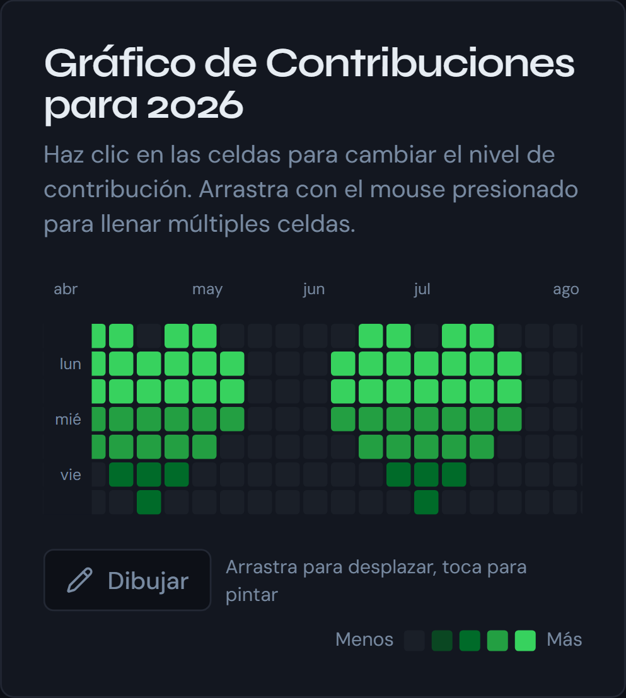

Commit Drawings is a web app where you draw a pattern on the GitHub contribution grid and it gives you back a script that recreates it with real, backdated commits. The result isn't an image: it's a repository with hundreds of commits spread over a year.

I started with the grid, which was the visible part, and the hard part turned out to be generating the commits. This post is about that and about how the grid behaves on a phone.

---

## The grid

The grid is 53 columns by 7 rows, a full year. Each cell is a date, and the first column starts on the weekday the 1st of January falls on, so the cells before that date and after the 31st of December stay empty:

```ts
const startDay = new Date(year, 0, 1).getDay();
// for every week and every day of the week:
const dayOffset = week * 7 + day - startDay;
const currentDate = new Date(year, 0, 1 + dayOffset);
```

A click cycles a cell through the five intensity levels, 0 to 4, and dragging fills several at once. All the state is a single object mapping dates to levels that lives in the page, and a day's level is the number of commits created that day. Commits are dated at 12:00 UTC so the time zone doesn't push one onto the neighbouring day.

---

## Why `git fast-import`

The obvious way to create the commits is a `git commit --date` loop. Every iteration starts a git process and touches the index and the working tree. `git fast-import` does the same thing by reading a text stream from standard input, in a single process.

I measured it with a three-heart pattern, which is 348 commits, in Git Bash on Windows: the loop takes 34.5 seconds and `fast-import` 0.26. Part of that gap is the cost of spawning processes on Windows, but the order of magnitude is what justifies the design.

The stream for each commit looks like this:

```
blob
mark :1
data 29
fun commit - 2026-04-12 (1/3)
commit refs/heads/main
mark :2
author Name <email> 1775995200 +0000
committer Name <email> 1775995200 +0000
data 10
fun commit
from :previous
M 100644 :1 contribution.txt
```

Each commit changes `contribution.txt` to different content, so there is one blob per commit. `data` declares the length, in bytes, of the block that follows.

---

## The grid on a phone

The first version shrank the cells so the 53 weeks fit the available width, with a minimum of 8 pixels. On a phone that needs about 616 pixels, so the page spilled off the screen: 657 wide on a 393 one.

Lowering the minimum was worse, because everything fit but with cells of around 4 pixels, too small to see or tap. The fix is the opposite: below 640 pixels the cells stay at 14 and the grid scrolls horizontally.



That collides with drawing by dragging, because on a touch screen dragging a finger already means scrolling. One finger scrolls and a tap paints a cell, and a **Draw** button turns the drag into painting. To make it work with both mouse and finger I use pointer events, and while dragging I look up the cell with `document.elementFromPoint`: on touch, events keep targeting the cell where the finger went down. Since a fast gesture skips several cells between two events, I sample the line between the two positions so no cell is left out.

---

## What I learned

Generating code for two different shells doubles the ways it can break, and testing the generator isn't enough: you have to run what it generates.

The project started from a template generated with Lovable and still carries unused dependencies and shadcn components.

---

The code is at [github.com/unaibermudez/github-commit-drawingsV2](https://github.com/unaibermudez/github-commit-drawingsV2) and the site at [github-commit-drawings.vercel.app](https://github-commit-drawings.vercel.app/).
