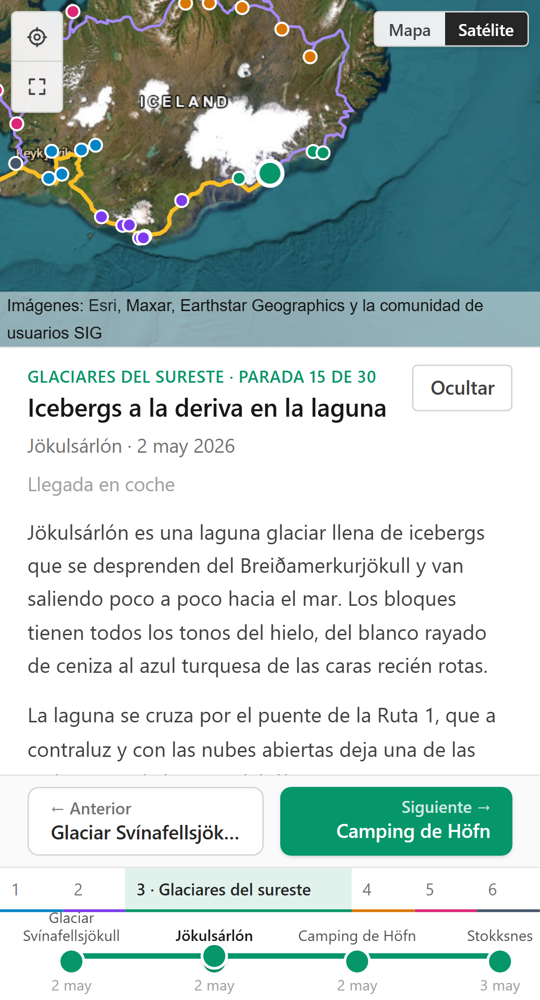

A long trip doesn't fit the usual tools. A photo album loses the order and the geography; a map with pins loses the story; a chronological blog doesn't let you see where you were. I wanted all three at once: a map with the route, a timeline that says what I visited on each date, and for every stop its text and photos.

That's TripMap. The map takes up most of the screen; below it there's a timeline split into chapters; next to it, a panel with the title, dates, text and photos of the active stop. Everything is in sync: it doesn't matter whether you click a point on the map, drag the timeline cursor or press the keyboard arrows.

The data in the repo is a real trip around Iceland: eleven days, thirty stops and my own photos, which is what you see in the screenshots throughout this post.

---

## The stack, and why React islands

| Piece | Choice |
| --- | --- |
| Framework | Astro with React islands |
| Language | Strict TypeScript |
| Map | MapLibre GL JS |
| Geometry | Turf.js |
| State | Zustand |
| Validation | Zod |
| Styles | Tailwind |
| Tests | Vitest and Playwright |

The starting decision was that the site is **static**: no backend, no database, no users. The content lives in the repository and is resolved at build time. To show a trip that's already written, a server adds nothing and does add cost and maintenance.

But the map isn't static: MapLibre needs WebGL, client state and events. That's where **islands** come in. Astro renders the page at build time and only the components you mark with a directive reach the browser with their JavaScript:

```astro
---
import { App } from '@/components/App';
---

<body>
  <App client:load />
</body>
```

My island fills the whole screen, so the byte savings over a regular React app are small. What I gain is an explicit boundary and not paying for a routing framework or SSR I don't use: the build produces an `index.html` and a few static files, which is what Pages knows how to serve.

And there is **a single island**, not three. Map, timeline and panel live inside the same `<App client:load />`. With three islands I'd depend on all of them sharing the same copy of the Zustand module, and if bundling duplicated it I'd end up with three independent stores and a very hard-to-see bug.

---

## A single state

There is **one central store** in Zustand. The map, the timeline and the panel read from it and write to it, and never talk to each other. Every way of navigating does the same thing: change `currentStopIndex`.

```ts
goToStop: (index) => {
  if (!Number.isFinite(index)) return;
  const target = Math.min(Math.max(Math.trunc(index), 0), lastIndex);
  // No change, no notification: the URL layer counts every notification as a
  // navigation and would add extra history entries.
  if (target === get().currentStopIndex) return;
  set({ currentStopIndex: target });
},
```

What isn't in the store matters as much as what is. The active chapter is derived from the active stop, and the URL isn't a parallel state but just another subscriber. The rule I set myself: if I catch myself writing a `useEffect` that syncs two components, the answer is in the store.

The URL reflects the stop as `?stop=<id>`, using the id and never the index, because indices shift when content is inserted and would break shared links. The history was what cost the most: if every stop change pushed an entry, dragging the timeline cursor would add dozens and the back button would become useless. Discrete navigation does `pushState`; dragging does `replaceState` while it lasts and, on release, leaves a single final entry.

---

## How the route is computed

The route isn't drawn by hand: the data is just the stops in order, and the line is generated from their coordinates. It has changed twice since the first version.

**First attempt: one spline over the whole route**, with `turf.bezierSpline`. The curve stops passing exactly through the stops, and "route travelled up to stop N" loses its cut point.

**Second attempt: one spline per leg**, concatenated:

```ts
const line = lineString([from.coords, ...leg.via, to.coords]);
return bezierSpline(line).geometry.coordinates;
```

Every stop lands exactly on the line, the travelled route is the concatenation of the first N legs, and a badly placed `via` (the optional array I use to fix legs where the curve goes somewhere I didn't pass) only ruins its own leg.

**Now: each leg according to how I travelled.** The spline is an invented curve, and in Iceland, where the trip is the ring road, a curve cutting through the interior tells something that didn't happen. The geometry now comes from three sources, by priority:

1. **Plane, train or boat:** a great-circle arc with `turf.greatCircle`.
2. **Car or bus:** the real road, if it's precomputed.
3. **Everything else:** the previous spline.

The roads don't come from a live call, because the site is static. A script, `npm run roads`, asks [OSRM](https://project-osrm.org/) for the route of every leg that doesn't have one yet and writes `src/data/generated/road-routes.json`, which gets committed like any other content. It's incremental, and it fails loudly: if OSRM finds no route, the script stops with an error naming the leg. A silent fallback would leave an invented curve passing as a road.

A routing engine snaps the point you ask for to the nearest road, so what it returns doesn't start or end exactly at the stop. That's why a `snapEndpoints` function forces the first and last points to the stop's exact coordinate, wherever the geometry comes from.

**The cost:** that JSON is imported as a module and ends up inside the bundle. With the 29 legs of Iceland it's already 1.2 MB, and the application bundle goes past 1.6 MB. The natural way out is moving it to `public/` and requesting it with `fetch`, at the price of the geometry computation no longer being synchronous.

---

## The map

I use MapLibre GL JS, the open fork of Mapbox GL, with two basemaps: CARTO Positron, a sober grey one, and satellite with Esri tiles. Both are served without a token and both require keeping their attribution visible while active.

That condition, which looks like a legal detail, ended up deciding the layout. The attribution sits at the bottom right of the map and has to be fully visible, so the panel can't float over it: it takes its place in the flow and the map shrinks. On mobile, the panel sheet stacks between the map and the timeline.

On performance, I don't use `maplibregl.Marker`. Every marker is a DOM element the browser repositions on every frame, and with over a hundred stops planned that doesn't hold up. The stops go in as a **GeoJSON source** with circle layers that WebGL draws. It was an up-front decision, not a measured optimisation: with thirty stops either option would do fine. Another trick comes from it: the active stop is a second layer on the same source, filtered by index, so changing stop is a `setFilter` and not sending all the features to the worker again.

When navigating, the map does a 1500 ms `flyTo`, except on the first framing and while the timeline cursor is being dragged. Since it isn't marked `essential`, anyone with `prefers-reduced-motion` gets a jump instead of a flight.

The two bugs that cost me the most failed the same way: a blank map, with no exception.

- **MapLibre's worker.** The library looks for it with `new URL('./maplibre-gl-worker.mjs', import.meta.url)`, which once bundled points to a directory where that file isn't. Without a worker no tile gets processed, and the only clue was a 404 in the network tab. It's fixed by importing it with `?worker&url` and passing the URL by hand with `setWorkerUrl`.
- **Switching basemap.** `setStyle` diffs against the previous style by default: it doesn't fire `style.load` and the trip layers are left hanging off sources that no longer exist. With `diff: false` the style loads whole, and since the layers are added on `style.load`, the same code serves to mount the map and to restore it after switching.

---

## The panel and the photos

The panel is what makes this an album and not just a map.



It's the same markup on desktop and mobile, with Tailwind variants. On desktop it's a side column; on mobile, a bottom sheet that starts folded, with the header and the previous and next buttons always visible. There are no media queries in JavaScript: the difference between the two modes is purely layout.

Each stop's text is written in markdown, but without a library: it's 62 lines that recognise paragraphs, bold, italics and links, and return React elements instead of injected HTML. It's pure logic, it's tested without a DOM and it saves me a sanitisation surface.

The photos come with a detail that isn't optional: the schema requires `width` and `height` for each one. Without those measurements the browser doesn't know how much space to reserve and the page jumps when the image loads. Before uploading them I strip their metadata, because it carries the exact location, and shrink them to 1600 pixels on the long side. Today I do that with a separate script, and bringing it into the repo is what's missing for that step to stop being manual.

---

## The timeline

I didn't use any timeline library: none of them did what I needed.


The scale is **uniform by index**, not proportional to time: three months in one place and two days in the next would make most stops impossible to click. Dates are labels, not position.

It has two levels on the same track: the chapters, always visible, and inside, the stops of the active chapter. And since the active chapter is derived from the stop, dragging the cursor into another chapter expands it by itself, with no "open chapter" state.

On mobile, with six chapters, the inactive ones left the active one with no width. Now the chapters become a 32-pixel row, with the active one shown by its title and the others by their number, and the stop track takes the full width.

Two accessibility details. The stop track is an ARIA `slider` instead of one button per stop: with over a hundred stops, buttons would fill the tab order, and the arrows are the natural interaction for a slider. And I had to turn off MapLibre's keyboard handling (`keyboard: false`): after clicking a pin, the canvas processed the arrows before they reached `window` and moved the map instead of changing stop.

---

## Code quality and tests

The project's rules are short: strict TypeScript with `any` forbidden, `noUncheckedIndexedAccess` on, all the pure logic in `src/lib`, and React components that only render and dispatch store actions.

`noUncheckedIndexedAccess` is the option that changed the code the most: indexing an array returns `T | undefined`, and in a project that lives on `stops[currentStopIndex]` it forces you to decide what happens at the edges, like the `i+1` of the last stop.

The data is validated on load. Zod handles the shape, and on top of that there are hand-written domain validations: unique ids, no orphaned chapters, contiguous stops within a chapter and a chain of legs that reproduces the order. All of them fail with a message naming the entities involved:

```
El capítulo "costa-sur" se reabre en la parada "borgarnes":
las paradas de un capítulo deben ser contiguas en el array.
```

It isn't defensive for its own sake: I write the content by hand in TypeScript, and these are the ways I'm going to get it wrong when adding many stops.

The **unit tests** are 160 with Vitest and run against `src/lib`: route geometry, store transitions, URL syncing, chapter grouping, dates and the markdown subset. They run in a `node` environment, with no DOM. Keeping the logic apart from the components is what makes them fast.

The **end-to-end tests** are Playwright and check the layout on desktop and mobile: that no element overflows the window, that the attribution stays visible, that the timeline navigates and that switching basemap and back doesn't leave the map without layers.

The oddest one detects the blank map. Headless has no GPU, Chromium falls back to SwiftShader, and since version 125 it doesn't create the WebGL context: MapLibre paints nothing and raises no error. Without decoding the image, the trick is the weight of the canvas PNG: a flat colour compresses to a few hundred bytes, and a painted map goes past a hundred thousand.

```ts
const CANVAS_BLANK_BYTES = 15_000;

await expect
  .poll(async () => (await canvas.screenshot()).byteLength, { timeout: 30_000 })
  .toBeGreaterThan(CANVAS_BLANK_BYTES);
```

Playwright doesn't run in CI, because it downloads the basemap from a CDN on every run and a CARTO or Esri outage would block the deploy with nothing actually broken. I run it locally when I touch the layout, and the screenshots it leaves on disk have shown me things no assert would have caught.

---

## What I learned

**A single state.** The version I'd have written a while ago would have the map notifying the timeline and a couple of `useEffect`s trying to keep them from stepping on each other. With a store in the middle, adding a new way to navigate touches nobody.

**External constraints decide more than they seem to.** The basemaps' mandatory attribution isn't a product requirement, but it's the reason the panel doesn't float over the map and why one of the tests checks that box stays inside the window.

**Writing the spec before the code.** What was valuable wasn't the plan, which changed, but that the document records the *why* of every decision with its cost. When I changed the route computation, the first thing I rewrote was the section saying the transport mode didn't affect rendering. It's still in the repo, at [docs/SPEC.md](https://github.com/unaibermudez/TripMap/blob/main/docs/SPEC.md).

---

## Future improvements

The immediate ones are automating the photo processing, moving the roads out of the JavaScript and getting a custom domain: being a GitHub Pages project site, it hangs off a subfolder.

The big one would be letting anyone create their own trip, with a menu of trips, accounts, and an editor to add their own points, notes and photos. That collides with the starting decision that this is a static site, so it will be a separate project, with a backend, and this version stays as 1.0.0.

---

## Deployment

GitHub Pages, with Actions on every push to `main`. The workflow installs, runs `typecheck` and the tests, and only then builds and publishes.

The detail with some substance is the `base`. The site hangs off `/TripMap/`, and that `base` is set **always**, not only in the CI build, so `npm run dev` also serves at `http://localhost:4321/TripMap/`. Setting it only in CI would leave the one production-like environment unverified, and a broken link would only show up once published. The risk is real with the photos: Astro rewrites the paths it sees, but the ones in the data I write by hand and they don't go through it. Without a prefix they'd 404 in production while the rest works, so all of them go through a `withBase` helper.

---

The code is at [github.com/unaibermudez/TripMap](https://github.com/unaibermudez/TripMap) and the site at [unaibermudez.github.io/TripMap](https://unaibermudez.github.io/TripMap/).
