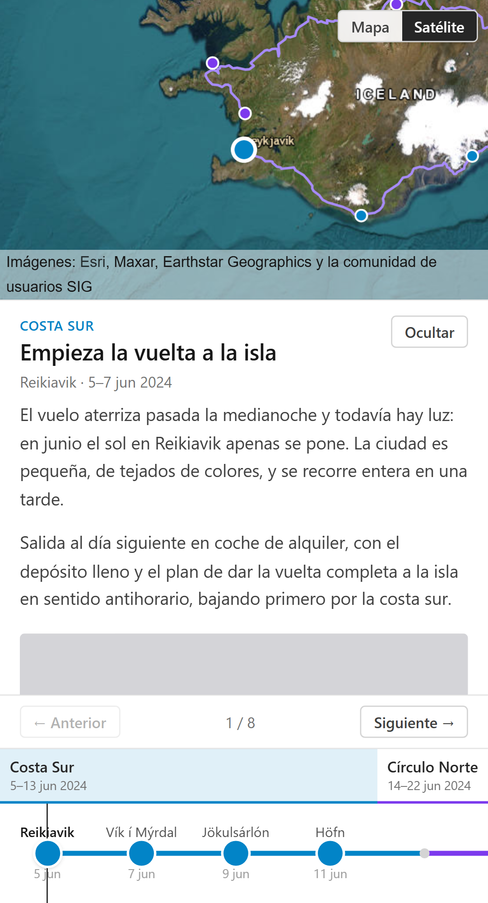
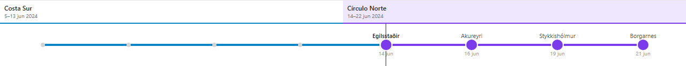

A long trip doesn't fit the usual tools. A photo album loses the order and the geography; a map with pins loses the story; a chronological blog doesn't let you see where you were. I wanted all three at once: a map with the route, a timeline saying what I visited on each date, and for every stop its text and its photos. Something like an interactive album where the map and time itself are the navigation.

That's TripMap. The map takes up most of the screen and draws the route and the stops; below it there's a timeline split into chapters; next to it, a panel with the title, dates, text and photos of the active stop. Everything stays in sync: it doesn't matter whether you click a point on the map, drag the timeline cursor, or use the arrow keys.

The trip that will fill it is a multi-year one across Africa, with over a hundred stops. While I get that content ready, the data in the repo is a test trip around Iceland with eight stops, which is what you see in the screenshots throughout this post.

---

## The stack, and why React islands

| Piece | Choice |
| --- | --- |
| Framework | Astro with React islands |
| Language | Strict TypeScript |
| Map | MapLibre GL JS |
| Geometry | Turf.js |
| State | Zustand |
| Validation | Zod |
| Styles | Tailwind |
| Tests | Vitest and Playwright |

The starting decision was that the site is **static**: no backend, no database, no users. The content lives in the repository and is resolved at build time. For a site that only has to display an already-written trip, a server adds nothing and does add cost and maintenance.

That leaves a tension: the content is static, but the map isn't. MapLibre needs WebGL, client state and events. This is where **islands** come in.

An island is an interactive component inside a page that is otherwise static HTML. Astro renders the whole page at build time and ships HTML; only the components you explicitly mark reach the browser with their JavaScript and hydrate. The rest of the page drags no runtime along. The marker is a directive on the component itself:

```astro
---
import { App } from '@/components/App';
---

<body>
  <App client:load />
</body>
```

`client:load` means "hydrate this as soon as the page loads". There are others: `client:idle` waits for the browser to go idle, `client:visible` waits for the component to enter the viewport. With no directive, the component is rendered to HTML at build time and no JavaScript ever reaches the browser.

It's worth being honest about what that buys here: my island covers the entire screen, so the byte savings over a regular React application are small. What I gain is an explicit boundary, since interactivity starts where I say it does and anything outside it is static HTML without me doing anything, plus not paying for a routing framework or SSR I never use: the build produces an `index.html` and a handful of static files, which is what Pages knows how to serve. Inside the island I picked React because MapLibre and a draggable timeline are real interactivity, with plenty of state and lifecycle.

What I did decide deliberately is that there is **a single island**, not three. Map, timeline and panel all live inside one `<App client:load />`. Three islands would share the Zustand module anyway, since it's the same module graph on the same page, but that assumption about bundling is fragile: if each island ended up in its own chunk with its own copy of the module, I'd have three independent stores and a very hard bug to spot.

---

## One single state

This comes before the features, because every feature follows from it.

There is **one single central state** in Zustand. The map, the timeline and the panel read from it and write to it, and never talk to each other. Every way of navigating does exactly the same thing: change `currentStopIndex`.

```ts
goToStop: (index) => {
  if (!Number.isFinite(index)) return;
  const target = Math.min(Math.max(Math.trunc(index), 0), lastIndex);
  // No change, no notification: the URL layer counts every notification as a
  // navigation and would push extra history entries.
  if (target === get().currentStopIndex) return;
  set({ currentStopIndex: target });
},
```

What isn't in the store matters as much as what is. The active chapter isn't stored: it's derived from the active stop. The URL isn't a parallel state either, it's just another subscriber. The rule I set for myself was: if I find myself writing a `useEffect` that syncs two components, the answer is in the store.

The URL reflects the stop as `?stop=<id>`, using the id and never the index, because indices shift as content is inserted and would break shared links. What took longer than expected was the history. If every stop change pushed an entry, dragging the timeline cursor would push dozens and the back button would be useless. Discrete navigation calls `pushState`; dragging calls `replaceState` while it lasts, and on release restores the starting URL before pushing the final one. The result is that a drag leaves exactly two entries: where you came from and where you dropped.

---

## How the route is calculated

The route isn't drawn by hand leg by leg: the data is just the stops in order, and the line is generated from their coordinates. How it's generated has changed twice since the first version, so here it is in order.

**First attempt: one spline over the whole route.** The obvious move was to take the full polyline of every stop and smooth it in one go with `turf.bezierSpline`, which turns a sequence of points into a continuous curve. That has two problems. First, the resulting curve stops passing exactly through the stops: the points end up beside their own route. Second, "route travelled up to stop N" loses its exact cut point, because I no longer know where to cut the global curve.

**Second attempt: a spline per leg.** Each leg generates its own geometry and they're concatenated afterwards:

```ts
const line = lineString([from.coords, ...leg.via, to.coords]);
return bezierSpline(line).geometry.coordinates;
```

This way every stop falls exactly on the line, the travelled route is the concatenation of the first N legs, and a badly placed `via` (the optional array of intermediate points I use to fix legs where the curve wandered somewhere I never went) only ruins its own leg instead of deforming the whole curve. The cost is that leg joins have a small angular kink instead of being smooth, which at continental scale you can't see. One case worth covering with a test: a leg with no `via` is two points, and `bezierSpline` with two coordinates returns a straight line.

**And now: each leg according to how I travelled it.** The spline solves the aesthetic problem, but it's still an invented curve. While the map sits at continental scale that doesn't matter; as soon as you zoom in, it shows. In Iceland the entire trip is the ring road, and a smooth curve cutting through the interior, where there is no road, is telling you something that didn't happen. So each leg's geometry now comes from three sources, in priority order:

1. **Plane, train or boat: a great circle arc.** None of the three follows a road, so they're drawn with `turf.greatCircle` between the two stops.
2. **Car or bus: the real road**, if it has been precalculated.
3. **Everything else: the previous spline**, unchanged.

This reverses a decision that was closed in the v1 spec: that a leg's `mode` was stored in the data but didn't change the rendering. No new field was needed, because `leg.mode` already meant "how I got to this stop"; what changed is that the map now reads it.

**Where the roads come from.** Not from a live call: the site is still static and, once deployed, talks to nobody. There's a script, `npm run roads`, that reads the stops and the legs, asks [OSRM](https://project-osrm.org/) for the route of every car or bus leg that doesn't have an entry yet, and writes `src/data/generated/road-routes.json`, which is committed like any other content. It's incremental, so it doesn't hammer the public demo server every time I add a stop, and it fails loud: if OSRM finds no route, the script stops with an error naming the leg. A silent fallback would be the worst thing it could do here, because it would leave an invented curve passing itself off as a road.

**A detail that isn't obvious:** a routing engine snaps the point you ask for to the nearest road, so what it returns doesn't start or end exactly at the stop. That's why, whatever the geometry came from, a `snapEndpoints` function forces the first and last point to the stop's exact coordinates. The guarantee the second attempt bought, that every stop sits on the line, no longer depends on what generated the leg.

**And the cost, which is worth stating.** That JSON is imported as a module, so its contents end up inside the application bundle. With Iceland's seven legs that's already around 760 KB, and it pushes the main bundle past 1 MB. It's acceptable at the current volume; at a hundred stops it won't be, and the natural way out is moving the JSON to `public/` and fetching it, at the cost of geometry calculation no longer being synchronous.

All of this is still pure logic over GeoJSON, with no React or DOM involved, and it's computed once per trip with `useMemo`.

---

## The map

I use MapLibre GL JS, the open fork of Mapbox GL. There are two basemaps: CARTO Positron, a muted grey style, and a satellite view with Esri tiles. Both are served without a token, and both require keeping their attribution visible while active.

That requirement, which looks like a legal footnote, ended up deciding the layout. Attribution sits at the bottom right of the map and has to stay fully visible, so the panel can't float over the map: it takes its place in the flow and the map shrinks. On mobile, the panel sheet stacks between the map and the timeline instead of overlaying them. It's the external constraint that shaped the design most, and it didn't come from any product requirement.

On performance, the decision that matters most is not using `maplibregl.Marker`. Each marker is a DOM element the browser repositions on every map frame, and at the expected volume, over a hundred stops, that doesn't hold up. The stops go in as a **GeoJSON source** with circle layers, drawn by WebGL. It's a decision made up front for that volume, not a measured optimisation: the test trip has eight stops, and at that size either approach would have been fine.

That leads to another trick: the active stop isn't a rewrite of the data, it's a second layer over the same source, filtered by index.

```ts
const activeStopFilter = (index: number): Filter => ['==', ['get', 'index'], index];
```

Changing stop is a `setFilter`, not sending a hundred features back to the worker.

When navigating, the map does a 1500 ms `flyTo`, except in two cases: the first framing, which jumps because there's nowhere to fly from, and while the timeline cursor is being dragged, where the flight wouldn't finish before the next change. The `flyTo` isn't marked as `essential`, so anyone with `prefers-reduced-motion` enabled gets a jump instead of a flight.

The two bugs that cost me the most time here failed the same way: a blank map, with no exception in the console.

The first was the MapLibre worker. The library looks for it with `new URL('./maplibre-gl-worker.mjs', import.meta.url)`, which once bundled points at the bundle directory, where that file isn't. With no worker, no tile gets processed. The only clue was a 404 in the network tab. The fix is importing it with `?worker&url` so Vite bundles it, and handing the URL over manually with `setWorkerUrl`.

The second was switching basemaps. By default `setStyle` diffs against the previous style instead of loading the new one whole: it doesn't fire `style.load` and the trip layers are left hanging off sources that no longer exist. With `diff: false` the style loads completely, and since the trip layers are added on `style.load`, which fires for the first style and every one after it, the same code both sets the map up and restores it after a switch.

---

## The panel and the photos

The panel is where the part that makes this an album rather than a map lives: the stop's title, its dates, the text and the photos.



It's the same markup on desktop and mobile, with Tailwind variants. On desktop it's a side column; on mobile, a bottom sheet that starts collapsed, with the header and the previous/next buttons always visible, so you can walk through the trip without losing sight of the map. There's no media query in JavaScript: checking the width on the client would force a first render without knowing it and drag a `resize` listener along, and the difference between the two modes is purely layout.

The stop body is written in markdown, but I don't use a markdown library. It's 62 lines that recognise paragraphs, bold, italics and links, and that return React elements rather than injected HTML: it's what a stop's text needs, it's pure logic, it's testable without a DOM, and it saves me a sanitisation surface I don't want to maintain.

The photos come with a detail that isn't optional: the schema requires `width` and `height` for each one. Without those measurements the browser doesn't know how much space to reserve and the page jumps when the image loads. Right now I write them by hand, which is exactly the kind of mechanical work that ends up being done badly, so measuring and compressing photos before they go into the repo is the next thing to automate.

In the screenshots throughout this post the photos are grey rectangles, because the test trip uses placeholders. That's the piece still missing for this to be finished.

---

## The timeline

I didn't use any timeline library. None of the ones I looked at did what I needed, and what I needed is fairly specific.



The scale is **uniform by index**, not proportional to time. On a multi-year trip, a real time scale leaves enormous gaps: three months in one place and two days in the next would make most stops unclickable. Dates are labels, not position.

It has two levels on the same track: chapters always visible, and the stops of the active chapter expanded inside. Both levels come out of the same distribution, since a chapter's band grows with `flex-grow` equal to its number of stops and each stop sits at `(index + 0.5) / total`, so they line up without syncing anything. And since the active chapter is derived from the stop, dragging the cursor into another chapter expands it on its own: there's no "open chapter" state to maintain.

Two accessibility details came out of this. The stop track is an ARIA `slider` rather than one button per stop: with over a hundred stops, buttons would flood tab navigation, and arrow keys are already a slider's natural interaction. And I had to disable MapLibre's keyboard handling (`keyboard: false`), because the canvas processes arrow keys before they reach `window` once it has focus: after clicking a pin, the arrows panned the map instead of changing stop.

---

## Code quality and tests

The project rules are short: strict TypeScript with `any` banned, `noUncheckedIndexedAccess` enabled, all pure logic in `src/lib`, and React components that only render and dispatch store actions.

`noUncheckedIndexedAccess` deserves a mention because it's the option that changed the code most. With it, indexing an array returns `T | undefined` instead of `T`. In a project that lives on `stops[currentStopIndex]`, that forces you to handle the case everywhere, and the temptation is to silence it with `!`. Where it found real things was at the edges: computing legs needs `stops[i]` and `stops[i+1]`, and the `i+1` of the last position doesn't exist; the partial route with an out-of-range index; the bounding box of a chapter with no stops. The flag doesn't find bugs on its own, it forces you to decide what happens in the cases you were about to ignore.

The data is validated on load. Zod handles the shape (coordinates, dates, country codes) and on top of that there are hand-written domain validations: unique ids, every stop's chapter exists, no chapter left without stops, stops of the same chapter contiguous in the array, and the leg chain reproducing the order of the stops. All of them fail with a message that names the entities involved. If while reordering the trip I leave a "Costa Sur" stop behind the "Círculo Norte" ones, the site doesn't start and says exactly this (the project's messages are in Spanish, since I'm the only one entering data):

```
El capítulo "costa-sur" se reabre en la parada "borgarnes":
las paradas de un capítulo deben ser contiguas en el array.
```

This isn't defensive for the sake of it. I write the content by hand in TypeScript files, and these are exactly the ways I'm going to get it wrong while entering a hundred stops.

The **unit tests** are 155 of them with Vitest, all against `src/lib`: route geometry, partial route, store transitions, URL syncing, chapter grouping, date formatting, the markdown subset. They run in a `node` environment, with no DOM. Keeping the logic separate from the components is exactly what makes these tests fast and free of React. What I don't unit test are the components, because by design they hold no logic worth testing.

That design paid off with the route change. Since choosing a source per leg is a pure function, the new tests inject a fake road table and check the priority between the three sources without booting a map or asking OSRM for anything.

The **end-to-end tests** use Playwright and have a different goal: they don't verify logic, they verify that the layout is correct on desktop and mobile. They check that nothing overflows the viewport, box by box, because the `body` is `overflow-hidden` and an overflow doesn't show up as page scroll, that attribution stays visible, that the timeline navigates, and that switching basemaps and back doesn't leave the map without its layers.

The most curious one is the check for a blank map. Headless has no GPU, Chromium falls back to SwiftShader, and since version 125 it considers that unsafe and never creates the WebGL context: MapLibre paints nothing and reports no error. The way to detect it without decoding the image is the weight of the canvas PNG: a flat colour compresses down to a few hundred bytes, and a painted map goes past a hundred thousand.

```ts
const CANVAS_BLANK_BYTES = 15_000;

await expect
  .poll(async () => (await canvas.screenshot()).byteLength, { timeout: 30_000 })
  .toBeGreaterThan(CANVAS_BLANK_BYTES);
```

It's a heuristic, but the threshold sits an order of magnitude away from both cases and it fails on the safe side: at worst a false negative, not a false alarm blocking the work.

Playwright doesn't run in CI: it needs a browser and downloads the basemap from a CDN on every pass, so a CARTO or Esri outage would block my deploy with nothing actually broken. I run it locally when I touch the layout, and it leaves screenshots on disk for review. The three images in this post come from there. That review caught something no assert would have: the timeline cursor drew its handle right on top of the active stop marker, and the two overlapped like a snowman.

---

## What I learned

The main thing I take away is the discipline of a single state. The version I'd have written a while ago would have the map notifying the timeline and a couple of `useEffect`s trying to keep them from stepping on each other: with four different ways to navigate, twelve possible paths between components. With a store in the middle it's four writes and three reads, and adding a fifth touches nobody.

The second is that external constraints decide more than you'd think. The basemaps' mandatory attribution isn't a product requirement or a design decision, but it's the reason the panel doesn't float over the map, the reason the mobile sheet stacks instead of overlaying, and the reason one of the e2e tests checks that box is still inside the viewport. It came from the terms of use of a free service and ended up fixing the layout.

The third is about writing the spec before the code. What was valuable wasn't the plan of increments, which changed, but that the document records the *why* behind each decision along with its accepted cost. It also serves to reverse those decisions deliberately: when I changed how the route is calculated, the first thing that had to be rewritten was the section saying that the travel mode didn't affect rendering, and now it holds both why one thing was decided and why the opposite was. It's still in the repo, at [docs/SPEC.md](https://github.com/unaibermudez/TripMap/blob/main/docs/SPEC.md).

---

## Future improvements

The immediate ones are real content, with actual photos instead of placeholders, automating how those photos get processed, and a custom domain: being a GitHub Pages project site, it hangs off a subfolder, and removing that means a `CNAME` and dropping `base` from the config. Plus getting back under a megabyte of bundle by moving the roads out of the JavaScript.

With the roads already calculated, real distances and times are closer than they were: OSRM returns them in the same response and today I only keep the geometry. The big one would be letting anyone create their own trip: an editor for "moments" (date, title, text and photos) with the route drawing itself live as you fill it in, a guest mode saving the draft to `localStorage`, and at some point accounts, a backend and image storage.

That last part collides head-on with the starting decision that this is a static site, so for now it lives in the backlog, not in the plan. What can be done without breaking it is the editor and the guest mode, which only need `localStorage`.

---

## Deployment

GitHub Pages, with Actions on every push to `main`. The workflow installs, runs `typecheck` and the tests, and only then builds and publishes. Those are the project's two "task finished" conditions; if they fail, nothing gets deployed.

The detail with some substance is `base`. The site hangs off `/TripMap/`, and that `base` is set **always**, not just in the CI build. That means `npm run dev` serves at `http://localhost:4321/TripMap/` instead of the root, which is slightly more awkward. The reason is that setting it only in CI would leave the one environment resembling production never verified: development and tests would stay at the root, and a broken link would only show up once published.

The photos prove that risk is real: Astro rewrites the paths it sees, but theirs are written by hand in the data and never pass through it. Without the prefix they'd 404 in production while the rest of the site worked, which is the worst way to break, so they all go through a `withBase` helper.

---

With this, the site does what I wanted: you open a URL, see the whole route at a glance, drag the cursor and watch where I was each week and what was there. What's left is the part with the least code and the most work in it, which is writing the trip.

The code is at [github.com/unaibermudez/TripMap](https://github.com/unaibermudez/TripMap) and the site at [unaibermudez.github.io/TripMap](https://unaibermudez.github.io/TripMap/).
