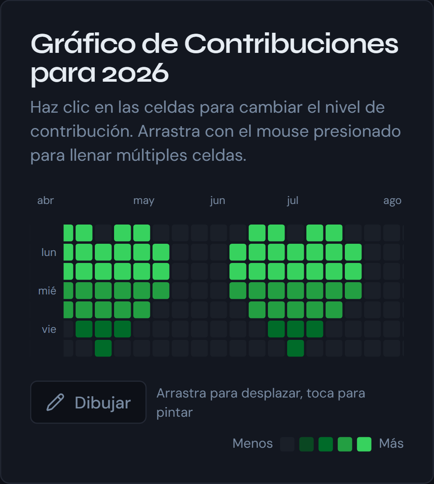

Commit Drawings es una web donde dibujas un patrón sobre la rejilla de contribuciones de GitHub y te devuelve un script que lo recrea con commits reales, con fecha retroactiva. El resultado no es una imagen: es un repositorio con cientos de commits repartidos por un año.

Empecé por la rejilla, que era la parte visible, y lo difícil resultó ser generar los commits. Este post trata de eso, y de un fallo que encontré al final: el script, tal como lo había dejado, no habría funcionado.

---

## La rejilla

La rejilla tiene 53 columnas por 7 filas, un año completo. Cada celda es una fecha, y la primera columna empieza en el día de la semana en que cae el 1 de enero, así que las celdas anteriores a esa fecha y posteriores al 31 de diciembre quedan vacías:

```ts
const startDay = new Date(year, 0, 1).getDay();
// para cada semana y cada día de la semana:
const dayOffset = week * 7 + day - startDay;
const currentDate = new Date(year, 0, 1 + dayOffset);
```

Con un click, una celda pasa por los cinco niveles de intensidad, del 0 al 4, y arrastrando se rellenan varias a la vez. Todo el estado es un único objeto de fecha a nivel que vive en la página, y el nivel de cada día es el número de commits que se crean ese día. Los commits se fechan a las 12:00 UTC, para que la zona horaria no mueva uno al día de al lado.

---

## Por qué `git fast-import`

La forma obvia de crear los commits es un bucle de `git commit --date`. Cada vuelta lanza un proceso de git y toca el índice y el árbol de trabajo. `git fast-import` hace lo mismo leyendo un stream de texto por la entrada estándar, en un solo proceso.

Lo medí con un patrón de tres corazones, que son 348 commits, en Git Bash sobre Windows: el bucle tarda 34,5 segundos y `fast-import` 0,26. La diferencia grande es en parte el coste de lanzar procesos en Windows, pero el orden de magnitud es el que justifica el diseño.

El stream de cada commit tiene este aspecto:

```
blob
mark :1
data 29
fun commit - 2026-04-12 (1/3)
commit refs/heads/main
mark :2
author Nombre <correo> 1775995200 +0000
committer Nombre <correo> 1775995200 +0000
data 10
fun commit
from :anterior
M 100644 :1 contribution.txt
```

Cada commit cambia `contribution.txt` con un contenido distinto, así que hay un blob por commit. `data` declara la longitud del bloque que viene a continuación, y ahí empiezan los problemas.

---

## Cinco fallos

**1. `data` cuenta bytes, no caracteres.** En el script de Bash, la longitud se saca con `${#var}`. Bajo un locale UTF-8, bash cuenta caracteres, así que una tilde en el mensaje del commit hace que el número declarado deje de ser el real y el stream se desincroniza. Se arregla con `export LC_ALL=C`, que fuerza la cuenta en bytes.

**2. No puede haber una línea en blanco tras un bloque `data`.** `fast-import` lee exactamente los bytes que le dices y espera el comando siguiente justo después. Si sobra una línea, aborta con `Unsupported command`, un error que no dice nada del problema real.

**3. `AppendLine()` mete CRLF.** En la versión de PowerShell construyo el stream con un `StringBuilder`. `AppendLine()` usa `Environment.NewLine`, que en Windows es CRLF, y ese `\r` rompe el formato, que exige saltos de línea LF. Hay que usar `Append()` con `` `n ``.

**4. PowerShell no tiene el operador `<`.** Está reservado y falla al interpretar el script. Para pasarle el stream a `fast-import` lo escribo a un archivo temporal y delego en `cmd /c`, que sí redirige los bytes sin tocarlos.

**5. El autor.** Este lo encontré al repasar el proyecto para escribir el post. El script firmaba todos los commits como `draw@github.local`, y GitHub solo cuenta un commit en tu perfil cuando el correo del autor está vinculado a tu cuenta. Con ese correo, el dibujo no habría aparecido. Nunca lo había probado de principio a fin.

Ahora los dos scripts leen `git config user.name` y `user.email`, y se detienen con un mensaje claro si falta alguno. Los ejecuté en repositorios temporales, uno por shell: 348 commits cada uno, con mi nombre y mi correo, y las tildes del mensaje intactas. Lo que no puedo comprobar desde aquí es la atribución en el perfil, que depende de que el correo esté verificado en la cuenta. Por eso las instrucciones de la web tienen ahora un cuarto paso que lo dice.

---

## La rejilla en el móvil

La primera versión encogía las celdas para que las 53 semanas cupieran en el ancho disponible, con un mínimo de 8 píxeles. En un móvil eso necesita unos 616 píxeles, así que la página se salía de la pantalla: 657 de ancho en una de 393.

Bajar el mínimo era peor, porque cabía todo pero con celdas de unos 4 píxeles, demasiado pequeñas para verlas y tocarlas. La solución es la contraria: por debajo de 640 píxeles las celdas se quedan en 14 y la rejilla se desplaza en horizontal.



Eso choca con dibujar arrastrando, porque en una pantalla táctil arrastrar un dedo ya significa desplazar. Un dedo desplaza y un toque pinta una celda, y un botón **Dibujar** convierte el arrastre en pintura. Para que funcione con ratón y con dedo uso eventos de puntero, y mientras se arrastra busco la celda con `document.elementFromPoint`: en táctil, los eventos siguen apuntando a la celda donde empezó el dedo. Como un gesto rápido salta varias celdas entre dos eventos, muestreo la línea entre las dos posiciones para no dejar huecos.

---

## Qué he aprendido

Tres de los cinco fallos no eran de git. Eran de codificación y de formato del stream, y los mensajes de error no apuntaban a la causa. Generar código para dos shells distintos duplica las formas de romperlo, y probar el generador no basta: hay que ejecutar lo que genera. El fallo del autor estaba a la vista y no lo vi hasta que lo ejecuté con una identidad real.

El proyecto arrancó desde una plantilla generada con Lovable y todavía arrastra dependencias y componentes de shadcn sin usar.

---

El código está en [github.com/unaibermudez/github-commit-drawingsV2](https://github.com/unaibermudez/github-commit-drawingsV2) y la web en [github-commit-drawings.vercel.app](https://github-commit-drawings.vercel.app/).
