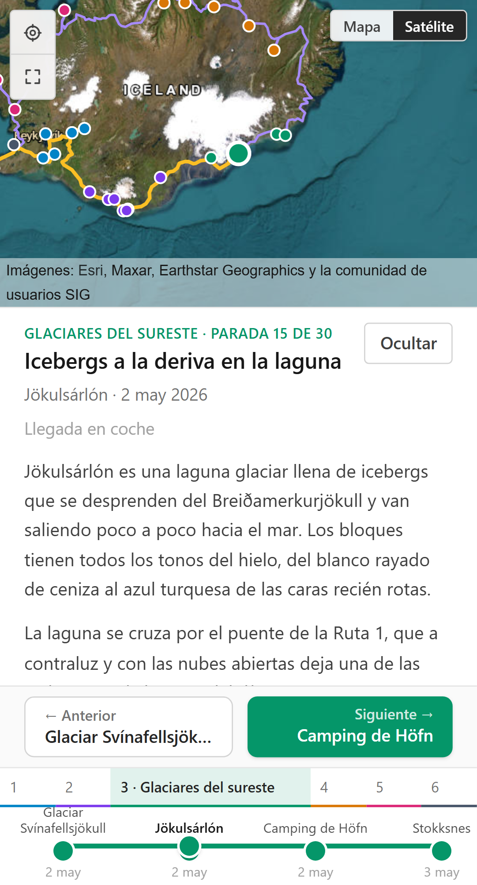

Un viaje largo se cuenta mal con las herramientas de siempre. Un álbum de fotos pierde el orden y la geografía; un mapa con chinchetas pierde el relato; un blog cronológico no te deja ver dónde estabas. Quería las tres cosas a la vez: un mapa con la ruta, una línea de tiempo que diga qué visité en cada fecha, y para cada parada su texto y sus fotos.

Eso es TripMap. El mapa ocupa casi toda la pantalla; abajo hay una línea de tiempo dividida en capítulos; al lado, un panel con el título, las fechas, el texto y las fotos de la parada activa. Todo está sincronizado: da igual si haces click en un punto del mapa, arrastras el cursor de la timeline o pulsas las flechas del teclado.

Los datos del repo son un viaje real por Islandia, de once días, con treinta paradas y fotos propias, y es lo que se ve en las capturas de este post.

---

## El stack, y por qué islas de React

| Pieza | Elección |
| --- | --- |
| Framework | Astro con islas de React |
| Lenguaje | TypeScript estricto |
| Mapa | MapLibre GL JS |
| Geometría | Turf.js |
| Estado | Zustand |
| Validación | Zod |
| Estilos | Tailwind |
| Tests | Vitest y Playwright |

La decisión de partida fue que el sitio es **estático**: sin backend, sin base de datos, sin usuarios. El contenido vive en el repositorio y se resuelve en build time. Para mostrar un viaje ya escrito, un servidor no aporta nada y sí añade coste y mantenimiento.

Pero el mapa no es estático: MapLibre necesita WebGL, estado en cliente y eventos. Ahí entran las **islas**. Astro renderiza la página en build time y solo los componentes que marcas con una directiva llegan al navegador con su JavaScript:

```astro
---
import { App } from '@/components/App';
---

<body>
  <App client:load />
</body>
```

Mi isla ocupa la pantalla entera, así que el ahorro de bytes frente a una aplicación de React normal es pequeño. Lo que gano es una frontera explícita y no pagar por un framework de rutas ni por SSR que no uso: el build produce un `index.html` y unos cuantos archivos estáticos, que es lo que Pages sabe servir.

Y hay **una sola isla**, no tres. Mapa, timeline y panel viven dentro del mismo `<App client:load />`. Con tres islas dependería de que todas compartan la misma copia del módulo de Zustand, y si el empaquetado la duplicara tendría tres stores independientes y un fallo muy difícil de ver.

---

## Un solo estado

Hay **un único estado central** en Zustand. El mapa, la timeline y el panel leen de él y escriben en él, y nunca se hablan entre sí. Todas las formas de navegar hacen lo mismo: cambiar `currentStopIndex`.

```ts
goToStop: (index) => {
  if (!Number.isFinite(index)) return;
  const target = Math.min(Math.max(Math.trunc(index), 0), lastIndex);
  // Sin cambio no se notifica: la capa de URL cuenta cada aviso como una
  // navegación y metería entradas de historial de más.
  if (target === get().currentStopIndex) return;
  set({ currentStopIndex: target });
},
```

Lo que no está en el store importa tanto como lo que está. El capítulo activo se deriva de la parada activa, y la URL no es un estado paralelo sino un suscriptor más. La regla que me puse: si me encuentro escribiendo un `useEffect` que sincroniza dos componentes, la respuesta está en el store.

La URL refleja la parada como `?stop=<id>`, con el id y nunca con el índice, porque los índices se desplazan al insertar contenido y romperían los enlaces compartidos. Lo que costó más fue el historial: si cada cambio empujara una entrada, arrastrar el cursor de la timeline metería decenas y el botón de atrás quedaría inservible. La navegación discreta hace `pushState`; el arrastre hace `replaceState` mientras dura y, al soltar, deja una sola entrada final.

---

## Cómo se calcula la ruta

La ruta no se dibuja a mano: los datos son solo las paradas en orden, y la línea se genera a partir de sus coordenadas. Ha cambiado dos veces desde la primera versión.

**Primer intento: un spline sobre la ruta entera**, con `turf.bezierSpline`. La curva deja de pasar exactamente por las paradas, y "ruta recorrida hasta la parada N" pierde su punto de corte.

**Segundo intento: un spline por tramo**, concatenados:

```ts
const line = lineString([from.coords, ...leg.via, to.coords]);
return bezierSpline(line).geometry.coordinates;
```

Cada parada cae exactamente sobre la línea, la ruta recorrida es la concatenación de los primeros N tramos, y un `via` mal puesto (el array opcional con el que corrijo los tramos donde la curva se va por donde no pasé) solo estropea su tramo.

**Ahora: cada tramo según cómo se viajó.** El spline es una curva inventada, y en Islandia, donde el viaje es la carretera de circunvalación, una curva que corta por el interior cuenta algo que no pasó. La geometría sale ahora de tres fuentes, por prioridad:

1. **Avión, tren o barco:** arco de gran círculo con `turf.greatCircle`.
2. **Coche o bus:** la carretera real, si está precalculada.
3. **El resto:** el spline de antes.

Las carreteras no salen de una llamada en vivo, porque el sitio es estático. Un script, `npm run roads`, le pide a [OSRM](https://project-osrm.org/) la ruta de cada tramo que todavía no la tenga y escribe `src/data/generated/road-routes.json`, que se comitea como cualquier otro contenido. Es incremental, y falla alto: si OSRM no encuentra ruta, el script para con un error que nombra el tramo. Un fallback silencioso dejaría una curva inventada haciéndose pasar por una carretera.

Un motor de rutas engancha el punto que le pides a la carretera más cercana, así que lo que devuelve no empieza ni acaba justo en la parada. Por eso una función `snapEndpoints` fuerza el primer y el último punto a la coordenada exacta de la parada, venga de donde venga la geometría.

**El coste:** ese JSON se importa como módulo y acaba dentro del bundle. Con los 29 tramos de Islandia son ya 1,2 MB y el bundle de la aplicación pasa de 1,6 MB. La salida natural es moverlo a `public/` y pedirlo con `fetch`, a cambio de que el cálculo deje de ser síncrono.

---

## El mapa

Uso MapLibre GL JS, el fork libre de Mapbox GL, con dos basemaps: CARTO Positron, sobrio en grises, y satélite con teselas de Esri. Los dos se sirven sin token y exigen mantener su atribución mientras están activos.

Esa condición, que parece un detalle legal, acabó decidiendo el layout. La atribución va abajo a la derecha del mapa y tiene que verse entera, así que el panel no puede flotar sobre él: ocupa su sitio en el flujo y el mapa se encoge. En móvil, la hoja del panel se apila entre el mapa y la timeline.

Sobre el rendimiento, no uso `maplibregl.Marker`. Cada marker es un elemento del DOM que el navegador reposiciona en cada frame, y con más de cien paradas previstas eso no se sostiene. Las paradas van como una **source de GeoJSON** con capas de círculos que dibuja WebGL. Fue una decisión a priori, no una optimización medida: con treinta paradas cualquiera de las dos opciones iría bien. De ahí sale otro truco: la parada activa es una segunda capa sobre la misma source, filtrada por índice, así que cambiar de parada es un `setFilter` y no volver a enviar todas las features al worker.

Al navegar, el mapa hace un `flyTo` de 1500 ms, salvo en el primer encuadre y mientras se arrastra el cursor de la timeline. Como no está marcado como `essential`, quien tenga `prefers-reduced-motion` obtiene un salto en vez de un vuelo.

Los dos bugs que más me costaron fallaban igual: el mapa en blanco, sin ninguna excepción.

- **El worker de MapLibre.** La librería lo busca con `new URL('./maplibre-gl-worker.mjs', import.meta.url)`, que una vez empaquetado apunta a un directorio donde ese archivo no está. Sin worker no se procesa ninguna tesela, y la única pista era un 404 en la pestaña de red. Se arregla importándolo con `?worker&url` y pasando la URL a mano con `setWorkerUrl`.
- **El cambio de basemap.** `setStyle` hace por defecto un diff con el style anterior: no dispara `style.load` y las capas del viaje se quedan colgando de sources que ya no existen. Con `diff: false` el style se carga entero, y como las capas se añaden en `style.load`, el mismo código sirve para montar el mapa y para reponerlo tras cambiar.

---

## El panel y las fotos

El panel es lo que hace que esto sea un álbum y no solo un mapa.



Es el mismo marcado en escritorio y en móvil, con variantes de Tailwind. En escritorio es una columna lateral; en móvil, una hoja inferior que empieza plegada, con la cabecera y los botones de anterior y siguiente siempre visibles. No hay media queries en JavaScript: la diferencia entre los dos modos es puramente de disposición.

El texto de cada parada se escribe en markdown, pero sin librería: son 62 líneas que reconocen párrafos, negrita, cursiva y enlaces, y devuelven elementos de React en vez de HTML inyectado. Es lógica pura, se testea sin DOM y me ahorra una superficie de sanitización.

Con las fotos hay un detalle que no es opcional: el esquema exige `width` y `height` para cada una. Sin esas medidas el navegador no sabe cuánto sitio reservar y la página da un salto al cargar la imagen. Antes de subirlas les quito los metadatos, porque llevan la ubicación exacta, y las reduzco a 1600 píxeles de lado largo. Hoy lo hago con un script aparte, y meterlo en el repo es lo que falta para que ese paso no sea manual.

---

## La línea de tiempo

No usé ninguna librería de timeline: ninguna hacía lo que necesitaba.


La escala es **uniforme por índice**, no proporcional al tiempo: tres meses en un sitio y dos días en el siguiente harían la mayoría de paradas inclicables. Las fechas son etiquetas, no posición.

Tiene dos niveles en la misma pista: los capítulos siempre visibles y, dentro, las paradas del capítulo activo. Y como el capítulo activo se deriva de la parada, arrastrar el cursor hasta otro capítulo lo expande solo, sin ningún estado de "capítulo abierto".

En móvil, con seis capítulos, los inactivos dejaban al activo sin ancho. Ahora los capítulos pasan a una fila de 32 píxeles, con el activo por su título y los demás por su número, y la pista de paradas ocupa todo el ancho.

Dos detalles de accesibilidad. La pista de paradas es un `slider` de ARIA en vez de un botón por parada: con más de cien paradas, los botones llenarían la navegación por tabulador, y las flechas ya son la interacción natural de un slider. Y hubo que desactivar el teclado de MapLibre (`keyboard: false`): tras hacer click en un pin, el canvas procesaba las flechas antes de que llegaran a `window` y movían el mapa en vez de cambiar de parada.

---

## Calidad de código y tests

Las reglas del proyecto son cortas: TypeScript estricto con `any` prohibido, `noUncheckedIndexedAccess` activado, toda la lógica pura en `src/lib`, y los componentes de React solo renderizan y disparan acciones del store.

`noUncheckedIndexedAccess` es la opción que más ha cambiado el código: indexar un array devuelve `T | undefined`, y en un proyecto que vive de hacer `stops[currentStopIndex]` te obliga a decidir qué pasa en los bordes, como el `i+1` de la última parada.

Los datos se validan al cargar. Zod se ocupa de la forma y encima hay validaciones de dominio escritas a mano: ids únicos, capítulos sin paradas huérfanas, paradas de un capítulo contiguas y una cadena de tramos que reproduzca el orden. Todas fallan con un mensaje que nombra las entidades implicadas:

```
El capítulo "costa-sur" se reabre en la parada "borgarnes":
las paradas de un capítulo deben ser contiguas en el array.
```

No es defensivo por gusto: el contenido lo escribo a mano en TypeScript, y estas son las formas en que me voy a equivocar al meter muchas paradas.

Los **tests unitarios** son 160 con Vitest y van contra `src/lib`: geometría de la ruta, transiciones del store, sincronización con la URL, agrupación en capítulos, fechas y el subconjunto de markdown. Corren en entorno `node`, sin DOM. Que la lógica esté separada de los componentes es lo que los hace rápidos.

Los **tests end-to-end** son de Playwright y verifican el layout en escritorio y en móvil: que ningún elemento se sale de la ventana, que la atribución sigue visible, que la timeline navega y que cambiar de basemap y volver no deja el mapa sin capas.

El más curioso detecta el mapa en blanco. En headless no hay GPU, Chromium cae en SwiftShader, y desde la versión 125 no llega a crear el contexto WebGL: MapLibre no pinta nada y no da ningún error. Sin decodificar la imagen, el truco es el peso del PNG del canvas: un color plano se comprime a unos cientos de bytes, y un mapa pintado pasa de cien mil.

```ts
const CANVAS_BLANK_BYTES = 15_000;

await expect
  .poll(async () => (await canvas.screenshot()).byteLength, { timeout: 30_000 })
  .toBeGreaterThan(CANVAS_BLANK_BYTES);
```

Playwright no va en CI, porque descarga el basemap de un CDN en cada pasada y una caída de CARTO o de Esri bloquearía el despliegue sin que hubiera nada roto. Lo ejecuto en local cuando toco el layout, y las capturas que deja en disco me han servido para ver cosas que ningún assert habría pillado.

---

## Mejoras futuras

Lo inmediato es automatizar el procesado de las fotos, sacar las carreteras del JavaScript y tener un dominio propio: al ser un project site de GitHub Pages, el sitio cuelga de una subcarpeta.

Lo grande sería que cualquiera pudiera crear su viaje, con un menú de viajes, cuentas, y un editor para añadir sus propios puntos, notas y fotos. Eso choca con la decisión de partida de que esto es un sitio estático, así que será un proyecto aparte, con backend, y esta versión se queda como la 1.0.0.

---

## El despliegue

GitHub Pages, con Actions en cada push a `main`. El workflow instala, pasa `typecheck` y los tests, y solo entonces construye y publica.

El detalle con miga es la `base`. El sitio cuelga de `/TripMap/`, y esa `base` está puesta **siempre**, no solo en el build de CI, así que `npm run dev` también sirve en `http://localhost:4321/TripMap/`. Ponerla solo en CI dejaría el único entorno parecido a producción sin verificar, y un enlace roto solo aparecería una vez publicado. El riesgo es real con las fotos: Astro reescribe las rutas que ve, pero las de los datos las escribo yo a mano y no pasan por él. Sin prefijo darían 404 en producción mientras el resto funciona, así que pasan todas por un helper `withBase`.

---

El código está en [github.com/unaibermudez/TripMap](https://github.com/unaibermudez/TripMap) y el sitio en [unaibermudez.github.io/TripMap](https://unaibermudez.github.io/TripMap/).
